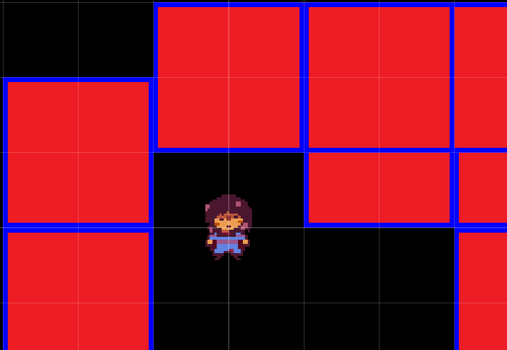
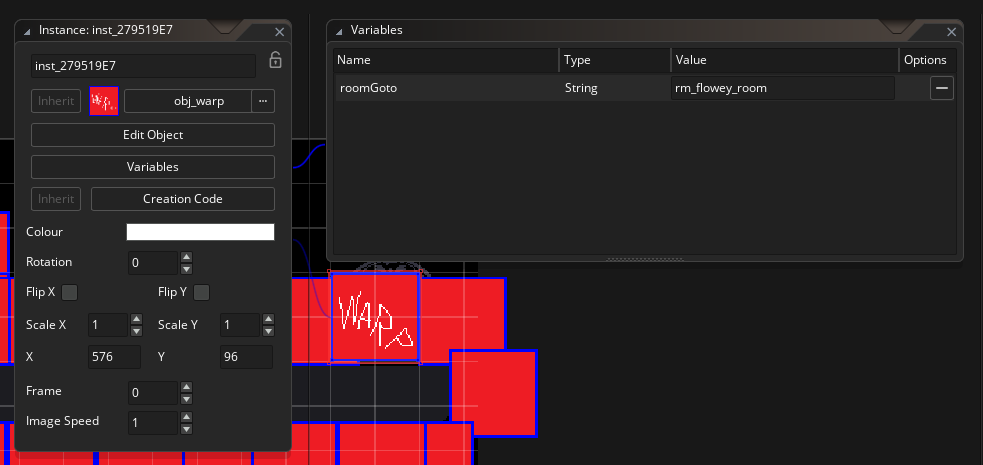
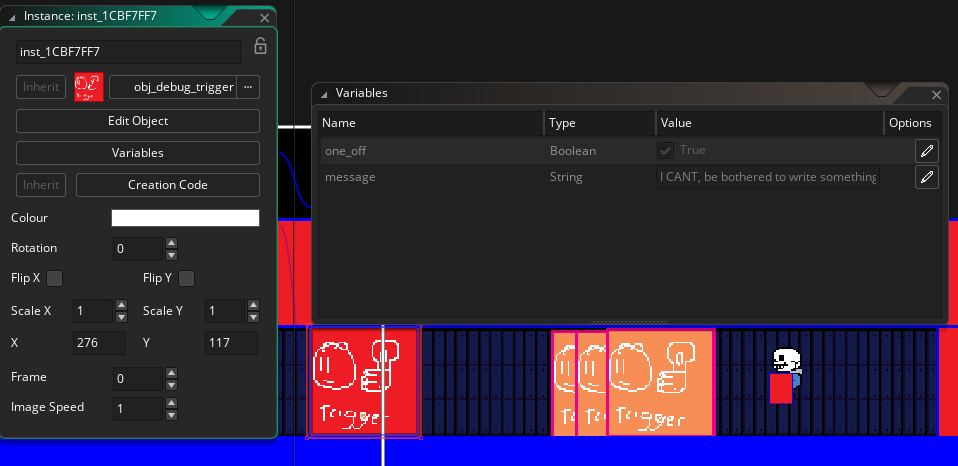
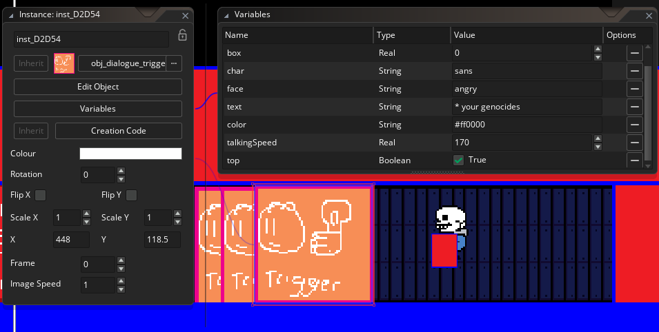
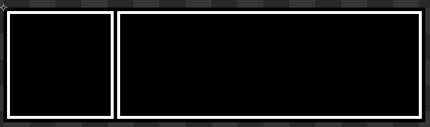
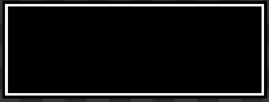
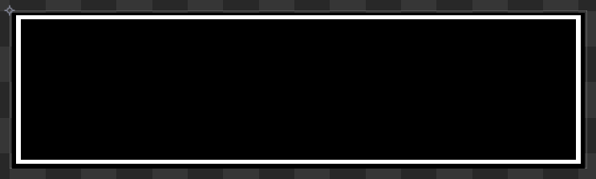
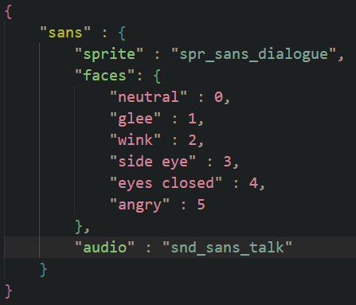

# Hello!

This is my page.

# DUSTALE I CANT

It's a dustale take for real for real. This repo is private so only the devs can see it lols

# DOCUMENTATION

> [!Warning]
> This documentation is currently maintained by just GoldenVoid(ThePortalGuy) so it may be semi-outdated. 
> 
> Also I'm not going to be keeping this too professional because its internal documentation so idrc

this is how the engine works
---
## Rooms
To make a new room simply duplicate rm_template as your base

### Wall collisions
--

--
Adding wall collisions is easy! Simply drag and drop as many of obj_collider as you want, change their shape! Move them around! The oyster is your world! Buuut you cant rotate them. collisions wont work :<


### Warp colliders
--

--
You can place this object at the exit of a room, when the player collides with it it will change rooms to the room with the same name as the name given in the object variable roomGoto

> [!note]
> This is set to rm_pitofdoomanddespair by default, so if you forget to set the exit that's where you'll end up

## Trigger system
> [!caution]
> This system is still work in progress, so more triggers will be added, and the way triggers work is subject to change.

The trigger system is a system that allows you to place trigger objects to achieve certain behaviours when the player interacts with the trigger, like trigger dialogue, cutscenes etc.

### General trigger stuff
--

All trigger's are controlled via their object variables. All triggers have a boolean setting called "oneoff" if this is set to true, the trigger will delete itself after it is triggered.

Triggers in general can be triggered by many things, but each specific trigger object is triggered by 1 particular thing (eg. debug triggers are always triggered by colliding with the player)

Things like:

+ Colliding with the player
+ Being interacted with a player input in the overworld (pressing x)

### Debug trigger
--

--

This trigger is triggered upon collision with the player. It does only 1 thing, and that prints whatever is in the message object variable to the console. It has no practical use other than for debugging and has no effect on gameplay.

### Dialogue trigger

--

--

This trigger is triggered by collision with the player.

This trigger opens a dialogue box, if you want to know how to use dialogue see the [dialogue section](#dialogue)

### Cutscene trigger and interact trigger

I'm putting both of these together as they do the same thing

Both of these trigger cutscenes, if you want to learn how to use cutscenes look at the [cutscene section](#cutscenes) 

## Dialogue

All dialogue is handled internaly by calling the scr_dialogue script with these parameters, things like the dialogue trigger or dialogue in cutscenes simply call the script with these parameters

### Box
---
This is a number from 0-2 that selects which box style to use as the text box. 

style 0:


style 1:


style 2:


### Char
---
This is a string which corrolates to what character is speaking. This is used to find what list of face sprites to use in the dialogue box. If this is set to "narrator" no face will appear (for good reason)

The list of characters can be found and modified in the faces.json file found in the datafiles for the project



here the faces corrospont to a mneumonic (what you put in the face variable which i'll go over in a minute) and the index of a frame of the sprite.

Note that any assets names used here must be added to the global.assetDict to work. See [adding assets](#adding-assets)

### Face
---

This is another string, in here you can put an mneumonic from the faces.json. (eg, angry, neutral, glee, etc)

This is the face that will be shown for the dialogue

### Text
---

This is the text that will be shown, be careful how you format the text. It is possible for it to run over outside the box. 

### Color
---
This is a string that represents a hexcode (if you dont know what one of those is look here https://en.wikipedia.org/wiki/Web_colors)

This is the color of the ENTIRE dialogue text. So all the text in the dialogue box wil be this color

>[!Note]
> I plan to move this over to a more complex system that uses special characters in the actual Text string to change colors per word etc

### Talking Speed
---
This is the number of milliseconds it will take to reveal each character of the dialogue text. So bigger number = slower talking

### Top
---
A boolean that if true means the dialgue box will appear on the top center of the screen, and if not it will appear on the bottom center.


## Cutscenes

### Explanation
All cutscenes are stored in the cutscenes folder of the datafiles. Usually if you are going to do any kind of extended action with a trigger, whether that be spawning object, playing audio, music, vfx or extended dialogue, you'll want to use a cutscene.
Hell even the save points use cutscenes.

Cutscene is a bit of an oversimplification. What a cutscene really is is a list of commands executed in order, each with a specific duration.

A cutscene file is structured like this

```json
{
    "scene" [
        //commands go here
    ]
}
```

Every command has the same basic structure

```json
["identifier", [parameters], duration]
```

The identifier is a string that represents what command the array represents.

the parameters are the settings for the command. For example the dialogue commands would take all the parameters outlined in the [dialogue section](#dialogue)

And the duration is how many milliseconds the command is run for.

> [!Note]
> By duration i mean thats how long until the next command is run. Setting the duration to 0 will not stop a command from running. So feel free to set commands like "changemusic" to 0 milliseconds duration. 
>
> There is also one exeption to this rule. The "dialogue" command will always pause the cutscene until the player presses X to dismiss the dialogue box. Its duration should be set to 0 to account for this.

### List of commands

>[!warning]
> This list isn't complete. I intend to add more commands over time. I will update this list when i do so. Please be patient while i work on these.


"" - string
[square brackets] - real
_italic_ - bool
**bold** - hexcode string

| Identifire | Parameters | Description |
| :---         |     :---      | --- |
| "changemusic"   | "mus_name of music"     | Changes the currently playing music to whatever music asset is denoted. obj_music_control **must** be in the room to work |
| "audiofor"    | "snd_audio_name"    | Plays the denoted sound asset for the duration of the command. Cuts off audio when command ends.|
|"audiostart"| "snd_audio_name"| Plays the denoted sound asset. **DOES NOT** cut off the audio after command finishes. The audio will play for its entire duration |
|"changeroom"| "rm_room_name"| Switches to the room denoted. This will end the cutscene|
|"dialogue"|[box],"character","face","text", **color**,[talking speed], _top_ | Creates a dialogue box with the given parameters, [see the dialogue section](#dialogue) for more details.|

## Adding assets

All assets, should you want to use them in any of the datafiles (such as faces.json or a cutscene) must first be added to the global.assetDict. This is to solve an issue where asset_index() would return nothing for names loaded from a variable (for some reason).

The global.assetDict initialization can be found in the create event of the obj_control.

```gml
    global.assetDict = {
        "snd_sans_talk" : snd_sans_talk,
        "mus_the_flower" : mus_the_flower
    }

```

Each of these entries has the name of the asset and its corrosponding asset index. To add an asset simply append its name and index to the list.

for example if i want to use mus_sans_breaks_it_down_for_you in a cutscene i first go to the create event at the obj_control and add it to the global.assetDict like this


```gml
    global.assetDict = {
        "snd_sans_talk" : snd_sans_talk,
        "mus_the_flower" : mus_the_flower,
        "mus_sans_breaks_it_down_for_you" : mus_sans_breaks_it_down_for_you
    }

```

then i can use it.

>[!caution]
> This **must** be done before using it or the game will crash when it tries to use the asset

